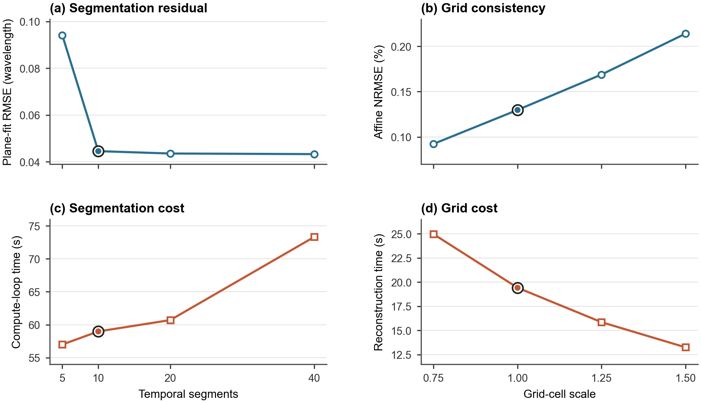

# Multi-GPU lunar-orbit radio-interferometric imaging

This branch is the curated code-and-results artifact for the manuscript
**“A Data-Intensive Multi-GPU Pipeline for Lunar-Orbit Radio Interferometric
Imaging with Approximation-Controlled Short-Time Stacking.”**

It contains the CUDA/C++ implementations used in the controlled experiments,
portable launch and analysis scripts, compact raw measurements, paper-facing
summary tables, and the data and script for the sensitivity figure. Large sky
maps, full-resolution reconstructed maps, compiled executables, and profiler
databases are deliberately excluded.

## Get this artifact

This is a self-contained artifact branch. Clone it directly with:

```bash
git clone --branch paper-artifact-v1 --single-branch \
  https://github.com/SSshuishui/viss_optimize_ws.git
cd viss_optimize_ws
```

## Artifact contents

| Component | Purpose | Recorded evidence |
|---|---|---|
| `source/final_sts` | Exact-group and representative-group STS | `results/sensitivity` and `results/controlled_method_comparison` |
| `source/direct_3d_reference` | Direct 3D+DCF reference implementation | `results/controlled_method_comparison` |
| `source/stream_30mhz` | Memory-bounded 30 MHz reconstruction | `results/slab_30mhz` |
| `experiments` | Five-day paired comparison and 1/2/4-GPU scaling wrappers | `results/scaling_and_orbital` |
| `results/summary` | Compact averages and scaling values used for manuscript tables | Three normalized CSV files |
| `figures` | Sensitivity-figure source and output | `sensitivity_tradeoff.png` |

For a detailed experiment-to-file mapping, see [`MANIFEST.md`](MANIFEST.md).
Input formats and exclusion policy are documented in [`DATA.md`](DATA.md).

## Evaluation environment

The reported experiments used:

- Linux kernel 5.15;
- CUDA 12.4 and GCC 11.4;
- four NVIDIA GeForce RTX 4090 GPUs with 24 GiB per GPU;
- CUDA architecture target `sm_89`.

The build scripts accept an explicit compiler path, for example:

```bash
NVCC=/usr/local/cuda-12.4/bin/nvcc ./build.sh
```

Absolute timings can change with GPU model, driver, compiler, NUMA placement,
and filesystem. Use the included logs and system records when comparing a new
run with the reported measurements.

## Input data

Set `SKY_DIR` to a directory containing the required sky map:

- `B_10M.bin` for the 10 MHz, HEALPix `Nside=4096` experiments;
- `B_30M.bin` for the 30 MHz, HEALPix `Nside=16384` experiments.

These maps are not included because of upstream redistribution terms and their
size. The direct 3D reference DCF is included at
`source/direct_3d_reference/dcf_mb_10M_days450_seed42.bin`.

## Build and run

Build the final STS implementation:

```bash
cd source/final_sts
./build.sh
```

Run the default 10 MHz representative-group configuration without writing the
full-resolution output map:

```bash
SKY_DIR=/path/to/earth_10Mhz GPUS=0,1,2,3 \
  WRITE_OUTPUT=0 ./scripts/run_one.sh
```

From the repository root, run the strong-scaling experiment:

```bash
SKY_DIR=/path/to/earth_10Mhz \
  ./experiments/run_scaling_10m.sh
```

Run the paired exact/representative comparison on the five sampled orbital
days:

```bash
SKY_DIR=/path/to/earth_10Mhz \
  ./experiments/run_five_day_paired_10m.sh
```

The paired script writes two full-resolution maps per day by default because
the accuracy calculation requires them. Set `WRITE_OUTPUT=0` only for a
timing-only run.

Instructions for the 3D+DCF and 30 MHz implementations are in their respective
source directories.

## Analysis and Figure 4

The analysis scripts require Python 3. Install the small Python dependency set
in an isolated environment:

```bash
python3 -m venv .venv
source .venv/bin/activate
python3 -m pip install numpy pandas matplotlib
```

Regenerate the sensitivity figure:

```bash
python3 figures/plot_sensitivity_tradeoff.py
```



## Result summaries

The paper-facing averages are provided separately from the raw per-day logs:

- `results/summary/five_day_method_average.csv`;
- `results/summary/five_day_accuracy_average.csv`;
- `results/summary/scaling_10mhz.csv`.

Historical logs retain the absolute paths recorded on the evaluation server.
All runnable scripts in this branch use repository-relative paths or explicit
environment variables.

## License and data availability

No license is asserted in this artifact yet. Add one only after confirming that
all source files and derived inputs may be redistributed under the selected
terms. Input sky maps and full-resolution reconstruction arrays should be
shared only where their source terms and repository limits permit it.
